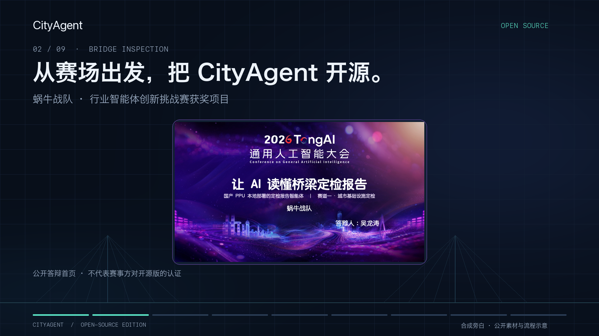
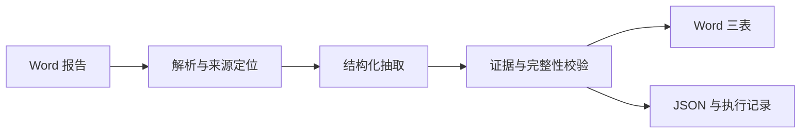

# CityAgent

**让 AI 读懂桥梁定检报告——从训练、推理到可追溯的结构化结果。**

[](https://github.com/eust-w/cityagent-public/actions/workflows/tests.yml)
[](pyproject.toml)
[](LICENSE)

**🏆 行业智能体创新挑战赛获奖项目 · 蜗牛战队**

[](docs/competition.md)

CityAgent 解析 Word 桥梁定期检测报告，抽取**基本信息、病害明细、养护建议**，生成三张 Word 表及结构化 JSON，并记录原文来源与校验结果。

仓库开放文档处理与推理代码，也包含 **SFT 数据准备、LoRA 训练、模型合并、W8A8 量化导出、评测与消融实验**。你可以先用无需模型的离线示例体验完整流程，再接入自有模型和数据。

[项目视频](#项目介绍视频) · [快速开始](#快速开始) · [训练](docs/training.md) · [量化](docs/quantization.md) · [实验评测](docs/experiments.md) · [答辩精选](docs/competition.md) · [架构](docs/architecture.md)

## 项目介绍视频

约 **82 秒**了解 CityAgent：获奖项目、文档智能与开源工具。

[](https://github.com/eust-w/cityagent-public/releases/download/showcase-20261025/CityAgent-intro-horizontal-1080p.mp4)

**在线观看：[B站](https://www.bilibili.com/video/BV15wH569EWp/) · [抖音](https://www.douyin.com/video/7700674738070244617) · [视频号（微信扫码）](https://weixin.qq.com/sph/AUwtuFBmx) · [YouTube](https://youtu.be/qCNVNKoxxwQ) · [X](https://x.com/eustancewu/status/2114311579089182857)**

**[▶ 观看横版介绍](https://github.com/eust-w/cityagent-public/releases/download/showcase-20261025/CityAgent-intro-horizontal-1080p.mp4)** · [手机竖版](https://github.com/eust-w/cityagent-public/releases/download/showcase-20261025/CityAgent-intro-vertical-1080p.mp4) · [中文字幕](https://github.com/eust-w/cityagent-public/releases/download/showcase-20261025/CityAgent-intro.zh-CN.srt) · [English subtitles](https://github.com/eust-w/cityagent-public/releases/download/showcase-20261025/CityAgent-intro.en.srt) · [视频下载与说明](https://github.com/eust-w/cityagent-public/releases/tag/showcase-20261025)

从桥梁定检报告到三张结构化表，了解文档处理、来源追溯、长报告任务和恢复机制。视频展示蜗牛战队获奖项目的答辩首页，也介绍已开源的训练、量化与评测工具。可以先运行无需模型的虚构报告示例；真实数据和模型权重需自行准备，RSI 默认关闭。

视频使用合成旁白、原创程序合成轻配乐、公开答辩封面与流程示意。代码采用 Apache-2.0；视频中的答辩图片与第三方标识不包含在代码许可中，使用范围见[视频素材说明](docs/assets/showcase/README.md)。

## 能做什么

| 能力 | 说明 |
|---|---|
| 文档解析 | 读取 DOCX 段落与表格；旧版 DOC 经转换和质量检查后处理 |
| 三表抽取 | 汇总基本信息、病害明细、养护建议，输出 Word 与 JSON |
| 来源与校验 | 保留来源定位，检查字段、证据及覆盖情况，记录未解决问题 |
| 长报告处理 | 高级入口支持分块任务、调用账本、检查点与身份匹配后的恢复 |
| 可选模型工作流 | 按部署条件接入模型服务、历史对比和跨报告查询 |
| 推理策略实验 | 提供有界修复与 RSI 接口；RSI 默认关闭，启用前需单独验收 |
| 模型训练 | 提供数据构造、LoRA 训练、长度分析、合并与生成评测工具 |
| 量化与性能实验 | 提供指定架构的 BF16 合并、动态 W8A8 导出及硬件探针；需独立准备兼容环境 |



## 快速开始

需要 **Python 3.11+**。以下命令适用于 macOS / Linux：

```bash
git clone https://github.com/eust-w/cityagent-public.git
cd cityagent-public
python3 -m venv .venv
source .venv/bin/activate
python -m pip install -e .

# 生成虚构报告，运行离线抽取
python examples/offline_demo.py --output-dir /tmp/cityagent-demo
```

示例无需模型、API 密钥或数据集，运行时不会发送模型请求。每次运行请选择一个**尚不存在的输出目录**，避免覆盖已有结果。

运行完成后可查看：

```text
/tmp/cityagent-demo/
├── synthetic-report.docx         # 虚构输入
├── result/synthetic-report.docx  # 三表结果
└── json/synthetic-report.json    # 结构化结果与校验状态
```

处理自己的 DOCX：

```bash
bridge-evidence single \
  --input /path/to/report.docx \
  --output-dir ./outputs \
  --json-dir ./outputs-json \
  --llm-mode off
```

默认关闭模型调用。离线规则的效果需要根据实际文档评估；示例用于验证软件流程，不是准确率基准。旧版 `.doc` 还需要系统转换工具，安装与批量处理步骤见[使用说明](docs/usage.md)。

## 选择运行入口

| 入口 | 适用场景 | 准备条件 |
|---|---|---|
| `bridge-evidence` | 离线解析、单份或批量处理、可配置在线工作流 | 基础 Python 环境；在线模式需额外配置自有服务 |
| `python run.py` | 模型身份校验、长报告分块、恢复及推理策略实验 | 自备模型与 tokenizer，按所选后端准备运行环境 |

高级入口、后端和工作流的验证条件各不相同。先查看 `python run.py --help` 和[高级入口说明](docs/usage.md#高级-runpy-入口)，再选择配置；不要把基础安装视为已具备所有推理依赖。

## 训练、量化与实验

| 想做什么 | 从哪里开始 |
|---|---|
| 使用自有报告构造 SFT 数据并训练 LoRA | [训练指南](docs/training.md)：数据准备、分割协议、训练入口、adapter 导出与合并 |
| 研究量化部署 | [量化指南](docs/quantization.md)：固定架构约束、BF16 与动态 W8A8 导出、运行时验证 |
| 比较抽取效果、速度与恢复能力 | [实验指南](docs/experiments.md)：评测协议、受控消融、吞吐与故障恢复 |
| 了解参赛方案与取舍 | [答辩精选](docs/competition.md)：首页、业务问题、架构、训练部署和可信执行 |

训练环境、CPU 工具环境和厂商推理环境分开准备。基础安装不会下载模型、启动训练或改装厂商 torch/vLLM。量化导出器有明确的架构和 LoRA 布局限制，不能直接用于任意模型。答辩页中的历史实验陈述不代表公开版在新硬件上的验收结果。

## 代码导航

| 路径 | 内容 |
|---|---|
| [`src/bridge_evidence/`](src/bridge_evidence/) | 解析、证据模型、抽取、校验与渲染 |
| [`src/bridge_evidence/contest/`](src/bridge_evidence/contest/) | 高级推理、任务恢复与 RSI 实验 |
| [`configs/`](configs/) / [`examples/`](examples/) | 通用配置与虚构报告示例 |
| [`tests/`](tests/) | 单元、回归与集成测试 |
| [`scripts/`](scripts/README.md) / [`experiments/`](experiments/README.md) | 按需运行的辅助工具与实验 |
| [`docs/`](docs/) | 使用、架构及发布验证说明 |

## 数据与安全

公开仓库提供代码、通用配置、合成测试样例和筛选后的答辩展示图片，**不分发真实报告、标签数据集、模型权重、LoRA 权重、第三方 SDK 或部署凭据**。这些资产需自行取得并遵守相应许可。完整 PPT、讲稿备注和真实报告截图也不在发布范围内。

实际报告、原文引用、输出 JSON、日志和检查点都可能含有敏感信息，请保存在受控目录。密钥通过环境变量或秘密管理服务注入；[`.env.example`](.env.example) 仅作变量说明。启用远端模型前，请确认有权向该服务发送文档。

提交 issue 或 PR 时，请使用虚构的最小复现；不要附真实报告、服务凭据或生产部署细节。漏洞报告与发布检查见 [SECURITY.md](SECURITY.md)。

## 开发与验证

```bash
python -m pip install -e '.[dev]'
python -m pytest -q
```

仓库附带 `uv.lock`，也可使用 `uv sync --locked --extra dev` 复现 CI 的依赖集合。开发流程见 [CONTRIBUTING.md](CONTRIBUTING.md)，已发布版本的验证范围见[发布验证记录](docs/release-validation.md)。

部分测试依赖可选资产、外部工具或 Linux 隔离能力。CPU 回归和虚构示例不能证明真实模型的质量、硬件速度或恢复性能；RSI 保持关闭，直至相应完整评测通过。

图片、图表、嵌入对象和复杂历史关系可能需要额外解析或人工核验。请检查校验状态与来源覆盖，不能仅凭文件已生成就认定抽取完整。

## 许可证

代码采用 [Apache License 2.0](LICENSE)。第三方组件说明见 [THIRD_PARTY_NOTICES.md](THIRD_PARTY_NOTICES.md)；代码许可证不覆盖外部模型、数据、SDK 以及[答辩展示素材](docs/assets/defense/README.md)。
