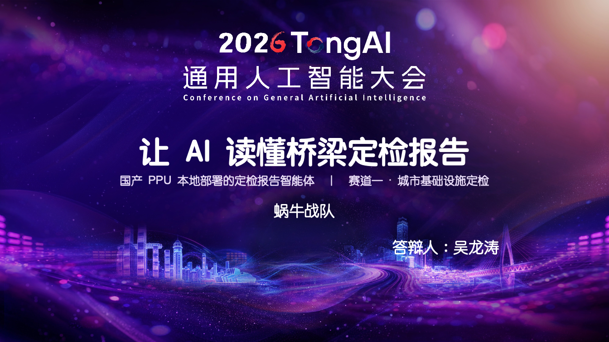
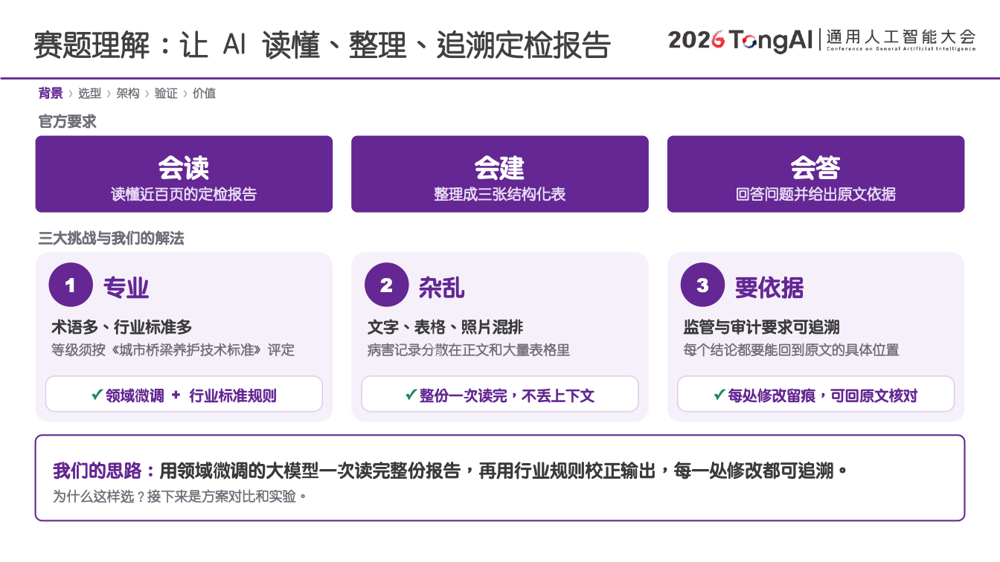
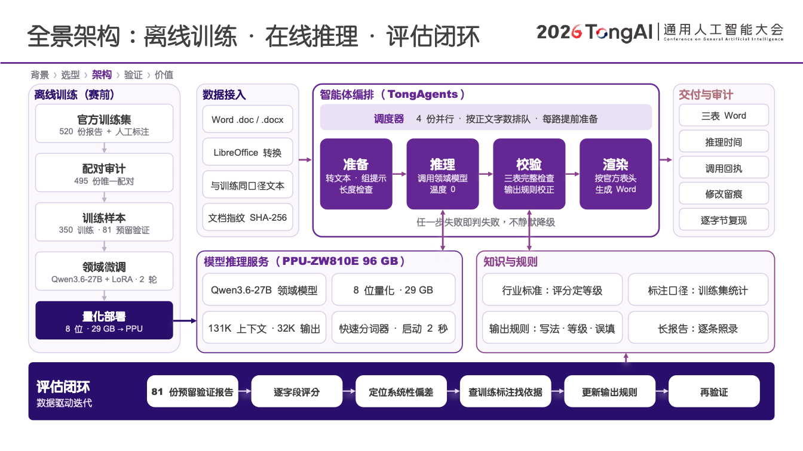
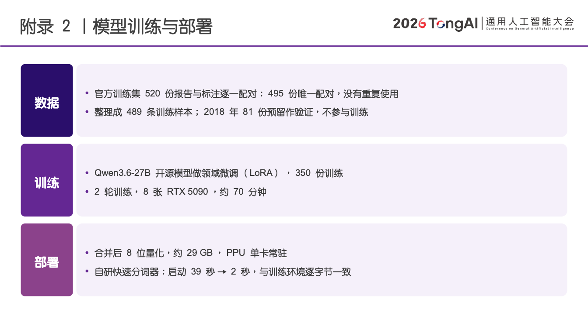
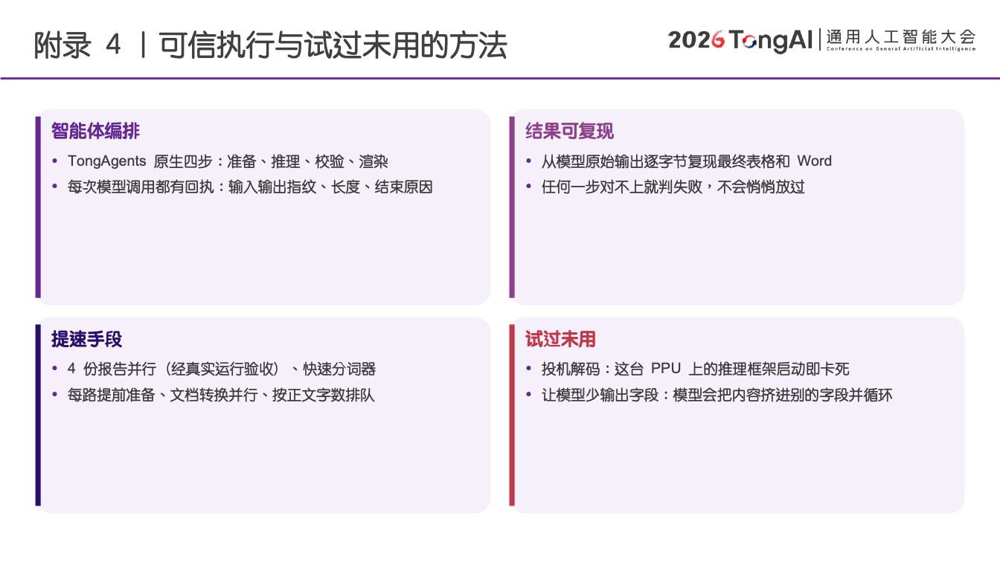

# 赛事与答辩

CityAgent 是**蜗牛战队**在 2026 行业智能体创新挑战赛的获奖项目，参赛方向为[赛道一：城市基础设施定检报告问答分析](https://iaic.cqaip.cn/tracks/ai-spatiotemporal)，答辩人为吴龙涛。此页展示项目方案，不发布未确认的奖项等级、名次或官方分数。

## 答辩首页

## 从长报告到有据可查的结果

桥梁定检报告包含长正文、复杂表格、行业术语和跨年的病害描述。CityAgent 将文档处理、结构化抽取、证据定位与结果校验连接起来，生成基本信息、病害明细、养护建议三张表。

## 训练、推理与评估

离线数据准备与 LoRA 训练独立于在线推理；推理使用明确的模型身份和配置，保留来源及调用记录；评测分别检查结果质量、耗时和恢复行为。公开代码的入口见[训练指南](training.md)、[量化指南](quantization.md)和[实验指南](experiments.md)。

以下三页是**答辩时的技术方案存档**。其中的数据数量、训练时长、硬件配置、并发及 tokenizer 性能属于当时的实验陈述，不是本次开源发布重新测得的指标，也不构成通用硬件或新数据集上的性能保证。公开版验证范围以[发布记录](release-validation.md)为准。

RSI 保持默认关闭。历史答辩中的并行运行或单项优化记录，不能替代冻结候选的完整质量、速度和恢复验收。

## 公开材料范围

这里只提供经过筛选的 5 张幻灯片图片。完整 PPT、讲稿备注、嵌入表格、真实报告截图及逐样本实验结果不随仓库分发。图片清单与校验和见 [manifest.json](assets/defense/manifest.json)。

代码采用 Apache-2.0；答辩素材和第三方活动标识的使用范围见[素材说明](assets/defense/README.md)。赛事名称、背景或标识不表示主办方为本开源版本提供认证。
